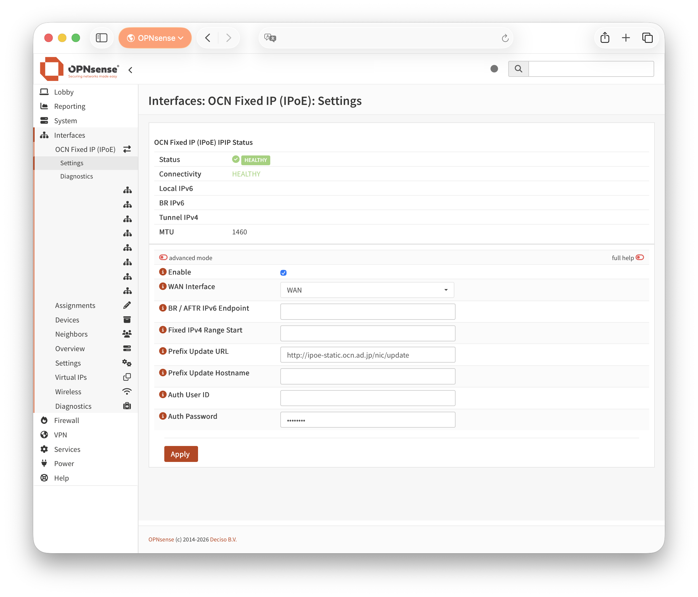
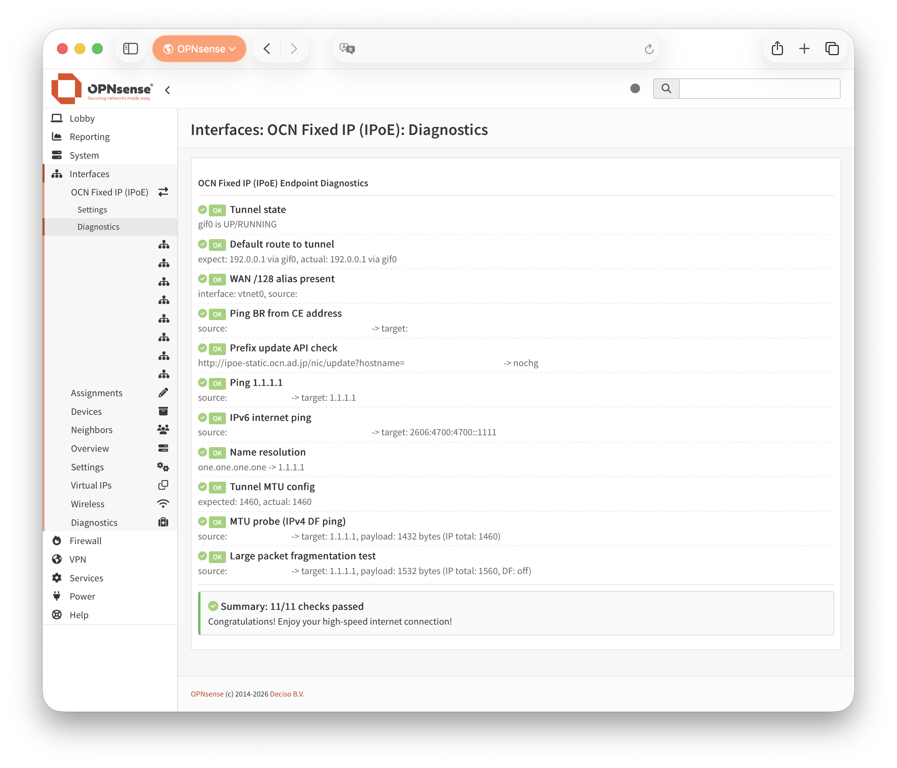

# OCN Fixed IP (IPoE) Plugin for OPNsense

[English](./README.md) | [日本語](./README_ja.md)

このリポジトリは、**OCN 固定IP (IPoE)** 向けの OPNsense プラグインです。  
（IPv4 over IPv6 / IPIP を `gif0` で構成）

> [!IMPORTANT]
> 本プラグインはコミュニティ実装です（NTTドコモビジネス/OPNsense公式ではありません）。
> デフォルトIPv4ルートが切り替わるため、作業時は必ずコンソール等の退避経路を確保してください。

## スクリーンショット

### Settings



### Diagnostics



## 概要

主な動作:

- `gif0` に OCN 固定IP 用 IPIP トンネルを構成
- トンネル peer IPv4 は固定 `192.0.0.1`
- WAN のグローバルIPv6 `/56` と固定IPv4開始アドレスから Local Tunnel IPv6 を自動計算
- Prefix Update API を起動時/Apply時/WAN IPv6更新時に実行
- Diagnostics と Widget で状態確認可能

## 要件

1. OPNsense 26.1+
2. WAN が IPoE IPv6（DHCPv6/PD）
3. OCN 固定IP 契約情報（BR IPv6、固定IPv4開始、更新URL、認証情報、hostname token）
4. OPNsense 管理権限（WebUI + shell）

## インストール

### GitHub Releases から導入

```sh
pkg add -f https://github.com/unchained-llc/os-ocnfixedip/releases/download/v2026.07.22/os-ocnfixedip-2026.07.22.1155.pkg
```

### ローカルでビルドした pkg を導入

```sh
pkg add -f /root/os-ocnfixedip/dist/os-ocnfixedip-*.pkg
```

インストール後は WebUI を一度ログアウト/再ログインしてください。

`configctl ocnfixedip ...` が `Action not allowed or missing` の場合は:

```sh
service configd restart
```

## 初期設定（重要）

1. **Interfaces > OCN Fixed IP (IPoE) > Settings** を開く
2. WANインターフェース、BR/AFTR IPv6、固定IPv4開始、Prefix Update情報を入力
3. Enable を有効化して Apply

その後、以下を必ず設定してください（未設定だと LAN 側 IPv4 通信不可）:

1. `gif0` が `TUNNEL` として割り当てられていることを確認
2. `TUNNEL` の IPv4 Gateway を作成/選択
3. Gateway 設定で **Upstream** を有効化
4. Gateway 設定で **Disable Gateway Monitoring** を有効化（必須）
5. Outbound NAT を `TUNNEL` 向けに設定
6. Normalization に `TUNNEL / Out / TCP / Max MSS 1420` を追加

### 推奨 Gateway 設定

- Interface: `TUNNEL`
- Address family: IPv4
- Gateway address: `192.0.0.1`
- Upstream gateway: enabled
- **Disable Gateway Monitoring: enabled (required)**

## 動作確認

```sh
configctl ocnfixedip status
configctl ocnfixedip diagnostics
ifconfig gif0
route -n get default
```

期待値の例:

- `gif0` が `RUNNING`
- デフォルトルートが `192.0.0.1`（`gif0`）
- status が `HEALTHY`

## アップグレード

```sh
pkg add -f https://github.com/unchained-llc/os-ocnfixedip/releases/download/v2026.07.22/os-ocnfixedip-2026.07.22.1155.pkg
```

必要に応じて:

```sh
service configd restart
```

## 再インストール

ネット断を避けるため、**先に delete せず上書き導入**を推奨:

```sh
pkg add -f /root/os-ocnfixedip/dist/os-ocnfixedip-2026.07.22.1155.pkg
service configd restart
```

## アンインストール

```sh
pkg delete -y os-ocnfixedip
```

※ アンインストール時、`/conf/config.xml` 内のプラグイン設定や、Gateway/NAT/Firewall/Normalization 等の周辺設定は自動削除されません。

## OPNsense 上で pkg をビルド

```sh
cd /root/os-ocnfixedip/os-ocnfixedip
make pkg
```

生成物:

- `/root/os-ocnfixedip/os-ocnfixedip/dist/*.pkg`

クリーン:

```sh
make clean
```

## 既知の制約

- OCN 固定IP (IPoE) 専用（汎用 DS-Lite / MAP-E ではない）
- トンネルIFは `gif0` 固定、peer IPv4 は `192.0.0.1` 固定
- Gateway/NAT/Firewall/MSS は自動作成しない
- 公式 OPNsense plugin repository には未登録（現状は `.pkg` 配布）

## ライセンス

BSD 2-Clause
